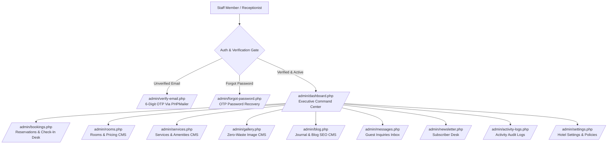

# Tiano Hotel & Suites — Admin Portal & Management System Guide

> **Document Type:** Administrative Architecture, Security & Operational Guide  
> **Directory Path:** `doc/ADMIN_PORTAL_AND_MANAGEMENT_SYSTEM.md`  
> **Target Project:** `Tiano-Hotel` (44 Marina Road, Eket, Akwa Ibom State, Nigeria)  
> **Status:** Production Architecture (Phase 7 Implemented)  
> **Last Updated:** October 2026  

---

## 1. Executive Summary & Portal Architecture

The Tiano Hotel & Suites Administration Portal provides a centralized, secure operations hub for front desk receptionists, operations managers, and general hotel administrators. Built with native PHP and PDO prepared statements, it adheres strictly to the brand design system (Crimson Red `#E73539`, Charcoal `#212529`, and clean rounded surfaces).



---

## 2. Admin Portal Directory & URL Map

All administrative controllers and templates reside inside the [`admin/`](file:///c:/xampp/htdocs/Tiano-Hotel/admin/) folder:

| Module / Screen | File Path | Browser Access URL | Description |
| :--- | :--- | :--- | :--- |
| **Staff Sign In** | [`admin/index.php`](file:///c:/xampp/htdocs/Tiano-Hotel/admin/index.php) | `http://localhost/Tiano-Hotel/admin/` | Secure login gate with CSRF & email verification checks |
| **Staff Sign Up** | [`admin/signup.php`](file:///c:/xampp/htdocs/Tiano-Hotel/admin/signup.php) | `http://localhost/Tiano-Hotel/admin/signup.php` | Register new staff accounts; dispatches 6-digit OTP |
| **Email Verification** | [`admin/verify-email.php`](file:///c:/xampp/htdocs/Tiano-Hotel/admin/verify-email.php) | `http://localhost/Tiano-Hotel/admin/verify-email.php` | Validates 6-digit OTP code or secret token link |
| **Forgot Password** | [`admin/forgot-password.php`](file:///c:/xampp/htdocs/Tiano-Hotel/admin/forgot-password.php) | `http://localhost/Tiano-Hotel/admin/forgot-password.php` | Dispatches password reset OTP to verified staff email |
| **Reset Password** | [`admin/reset-password.php`](file:///c:/xampp/htdocs/Tiano-Hotel/admin/reset-password.php) | `http://localhost/Tiano-Hotel/admin/reset-password.php` | Sets new password with 6-digit OTP verification |
| **Executive Dashboard & Earnings** | [`admin/dashboard.php`](file:///c:/xampp/htdocs/Tiano-Hotel/admin/dashboard.php) | `http://localhost/Tiano-Hotel/admin/dashboard.php` | Chart.js revenue histogram, settlement donuts, earnings ledger & PDF export |
| **Reservations & Bookings** | [`admin/bookings.php`](file:///c:/xampp/htdocs/Tiano-Hotel/admin/bookings.php) | `http://localhost/Tiano-Hotel/admin/bookings.php` | Search, filter, assign physical rooms, record payments, view special requests |
| **Rooms & Pricing CMS** | [`admin/rooms.php`](file:///c:/xampp/htdocs/Tiano-Hotel/admin/rooms.php) | `http://localhost/Tiano-Hotel/admin/rooms.php` | Dual-tab matrix: category rates & amenities builder + physical housekeeping |
| **Services CMS** | [`admin/services.php`](file:///c:/xampp/htdocs/Tiano-Hotel/admin/services.php) | `http://localhost/Tiano-Hotel/admin/services.php` | Dynamic hotel services, amenities list, quotes, and image uploader |
| **Gallery Media CMS** | [`admin/gallery.php`](file:///c:/xampp/htdocs/Tiano-Hotel/admin/gallery.php) | `http://localhost/Tiano-Hotel/admin/gallery.php` | Zero-waste WebP image upload & compression |
| **Journal & Blog SEO CMS** | [`admin/blog.php`](file:///c:/xampp/htdocs/Tiano-Hotel/admin/blog.php) | `http://localhost/Tiano-Hotel/admin/blog.php` | SEO articles editor, cover photo upload, Google meta settings, draft/publish |
| **Activity Audit Logs** | [`admin/activity-logs.php`](file:///c:/xampp/htdocs/Tiano-Hotel/admin/activity-logs.php) | `http://localhost/Tiano-Hotel/admin/activity-logs.php` | Security audit trail of logins, booking changes, and CMS updates |
| **Hotel Settings & Policies** | [`admin/settings.php`](file:///c:/xampp/htdocs/Tiano-Hotel/admin/settings.php) | `http://localhost/Tiano-Hotel/admin/settings.php` | Concierge WhatsApp, contact lines, check-in policies, and canonical SEO URL |
| **Inbound Messages** | [`admin/messages.php`](file:///c:/xampp/htdocs/Tiano-Hotel/admin/messages.php) | `http://localhost/Tiano-Hotel/admin/messages.php` | Contact form inquiries management |
| **Newsletter Desk** | [`admin/newsletter.php`](file:///c:/xampp/htdocs/Tiano-Hotel/admin/newsletter.php) | `http://localhost/Tiano-Hotel/admin/newsletter.php` | Newsletter subscribers holding desk |
| **Sign Out Action** | [`admin/logout.php`](file:///c:/xampp/htdocs/Tiano-Hotel/admin/logout.php) | `http://localhost/Tiano-Hotel/admin/logout.php` | Secure session destruction and cookie wipe |

---

## 3. Initial Administrative Credentials

| Parameter | Default Master Account | Notes |
| :--- | :--- | :--- |
| **Username / Email** | `support@tianohotelandsuites.com` *(or `admin`)* | Primary Superadministrator |
| **Initial Password** | `Admin@Tiano2026` | Changeable via `/admin/reset-password.php` |
| **Verification State** | Pre-verified (`is_verified = 1`) | Unrestricted dashboard access |
| **Access Role** | `super_admin` | Full operational rights |

---

## 4. PHPMailer & Live SMTP Infrastructure

Transactional messaging is powered by **PHPMailer** configured inside [`include/mailer.php`](file:///c:/xampp/htdocs/Tiano-Hotel/include/mailer.php):

### SMTP Server Settings
- **Host:** `s9621.fra1.stableserver.net`
- **Port:** `465` (SSL encryption via `PHPMailer::ENCRYPTION_SMTPS`)
- **Username:** `support@tianohotelandsuites.com`
- **Sender Display:** `Tiano Hotel & Suites`
- **Branded Template:** [`buildTianoEmailTemplate()`](file:///c:/xampp/htdocs/Tiano-Hotel/include/mailer.php#L131-L225) featuring charcoal `#212529` headers and crimson `#E73539` call-to-actions.

### Automated Email Triggers
1. **Admin Staff Registration Verification:** Dispatches 6-digit OTP code valid for 30 minutes.
2. **Admin Password Recovery:** Dispatches 6-digit reset OTP valid for 20 minutes.
3. **Guest Booking Pass (Dual Notification):** Instantly emails the guest a branded HTML voucher with room details, dates, amount due upon arrival, check-in instructions, and link to [`voucher.php`](file:///c:/xampp/htdocs/Tiano-Hotel/voucher.php).
4. **Hotel Reception Alert (Dual Notification):** Dispatches real-time reservation notifications to `support@tianohotelandsuites.com`.
5. **Contact Inquiries:** Forwards website contact inquiries to reception inbox.

---

## 5. Security & Authentication Protocols

1. **Password Hashing:** Passwords are never stored in plain text; they use `password_hash($pass, PASSWORD_DEFAULT)` and are verified via `password_verify()`.
2. **Session Regeneration:** Sessions call `session_regenerate_id(true)` upon successful authentication to neutralize session fixation attacks.
3. **Email Verification Enforcement:** If a staff account has `is_verified = 0`, login attempts immediately redirect to [`admin/verify-email.php`](file:///c:/xampp/htdocs/Tiano-Hotel/admin/verify-email.php) with a freshly generated 6-digit OTP.
4. **CSRF Tokens:** All state-changing POST forms (Login, Registration, Password Reset, Room Updates, Booking Updates) validate a cryptographic token (`validateCsrf()`).
5. **PDO Prepared Statements:** 100% of SQL transactions use bound parameters.

---

## 6. Front Desk Reservations & Booking Desk (`admin/bookings.php`)

The reservation management portal equips front desk staff with complete control over guests arriving at 44 Marina Road:

### Features & Capabilities:
- **Real-Time Search Bar:** Instantly searches bookings by reference number (`THS-XXXXXX`), guest full name, email, or telephone number.
- **Status Filtering Tabs:**
  - `All Bookings`: Complete chronological log.
  - `Confirmed`: Reserved guests arriving soon.
  - `Checked In`: In-house guests currently staying in physical rooms.
  - `Completed`: Checked-out guests with settled bills.
  - `Cancelled`: Cancelled or no-show bookings.
- **Interactive Check-In / Edit Modal:**
  - **Assign Physical Room:** Select from individual physical rooms (e.g. Room 101, 102, 204, 301, PH-01). Automatically updates room occupancy status to `occupied`.
  - **Guest ID Verification:** Record official identity document (`National ID (NIN)`, `Driver's License`, `International Passport`, `Voter's Card`) and serial number.
  - **Payment Settlement:** Update payment status (`Unpaid` &rarr; `Paid`) and record physical settlement method (`POS Card Terminal`, `Physical Cash`, `Instant Bank Transfer`).
  - **Front Desk Staff Notes:** Log arrival requests, early check-in approvals, or caution deposit refund receipts.
- **1-Click WhatsApp Direct Chat:** Generates a pre-filled WhatsApp concierge chat link directly to the guest's phone number containing their booking reference and stay details.
- **1-Click Digital Printable Pass:** Opens the exact high-impact printable voucher ([`voucher.php`](file:///c:/xampp/htdocs/Tiano-Hotel/voucher.php)).

---

## 7. Rooms & Housekeeping Matrix (`admin/rooms.php`)

Maintains real-time hotel room availability and turnover across all wings:

- **Floor 1 (Coral Wing):** Rooms 101, 102, 103, 104
- **Floor 2 (Gold Wing):** Rooms 201, 202, 203, 204
- **Floor 3 (Diamond Wing):** Rooms 301, 302, 303
- **Floor 4 (Executive Wing):** Rooms 401, 402
- **Floor 5 (Penthouse Level):** Room PH-01 (Presidential Suite)

### Status Matrix:
- **Cleanliness:** `Clean` 🟢, `Inspected` 🔵, `Dirty` 🟡, `Under Maintenance` 🔴
- **Occupancy:** `Vacant`, `Occupied`, `Reserved`

---

## 8. Database Architecture Reference

### A. Staff Users Table (`admin_users`)
```sql
CREATE TABLE IF NOT EXISTS `admin_users` (
  `id` INT AUTO_INCREMENT PRIMARY KEY,
  `username` VARCHAR(50) NOT NULL UNIQUE,
  `fullname` VARCHAR(100) NOT NULL,
  `email` VARCHAR(150) NOT NULL UNIQUE,
  `password_hash` VARCHAR(255) NOT NULL,
  `role` ENUM('super_admin', 'manager', 'receptionist') DEFAULT 'receptionist',
  `is_verified` TINYINT(1) NOT NULL DEFAULT 0,
  `verification_token` VARCHAR(100) DEFAULT NULL,
  `verification_code` VARCHAR(10) DEFAULT NULL,
  `verification_expires` DATETIME DEFAULT NULL,
  `reset_token` VARCHAR(100) DEFAULT NULL,
  `reset_code` VARCHAR(10) DEFAULT NULL,
  `reset_expires` DATETIME DEFAULT NULL,
  `last_login` DATETIME DEFAULT NULL,
  `status` ENUM('active', 'inactive') DEFAULT 'active',
  `created_at` TIMESTAMP DEFAULT CURRENT_TIMESTAMP,
  `updated_at` TIMESTAMP DEFAULT CURRENT_TIMESTAMP ON UPDATE CURRENT_TIMESTAMP
);
```

### B. Bookings Table (`bookings`)
Linked to `room_categories.id` and `rooms.id` via foreign keys:
```sql
CREATE TABLE IF NOT EXISTS `bookings` (
  `id` INT AUTO_INCREMENT PRIMARY KEY,
  `booking_reference` VARCHAR(30) NOT NULL UNIQUE,
  `category_id` INT NOT NULL,
  `assigned_room_id` INT DEFAULT NULL,
  `guest_name` VARCHAR(150) NOT NULL,
  `guest_email` VARCHAR(150) NOT NULL,
  `guest_phone` VARCHAR(50) NOT NULL,
  `id_type` VARCHAR(50) DEFAULT NULL,
  `id_number` VARCHAR(100) DEFAULT NULL,
  `check_in_date` DATE NOT NULL,
  `check_out_date` DATE NOT NULL,
  `adults` INT DEFAULT 1,
  `children` INT DEFAULT 0,
  `nights` INT NOT NULL DEFAULT 1,
  `nightly_rate` DECIMAL(10,2) NOT NULL,
  `total_amount` DECIMAL(10,2) NOT NULL,
  `caution_deposit` DECIMAL(10,2) DEFAULT 0.00,
  `payment_method` ENUM('pay_on_arrival', 'pos', 'cash', 'bank_transfer') DEFAULT 'pay_on_arrival',
  `payment_status` ENUM('unpaid', 'partially_paid', 'paid', 'refunded') DEFAULT 'unpaid',
  `booking_status` ENUM('pending', 'confirmed', 'checked_in', 'completed', 'cancelled', 'no_show') DEFAULT 'confirmed',
  `special_requests` TEXT DEFAULT NULL,
  `admin_notes` TEXT DEFAULT NULL,
  `created_at` TIMESTAMP DEFAULT CURRENT_TIMESTAMP,
  `updated_at` TIMESTAMP DEFAULT CURRENT_TIMESTAMP ON UPDATE CURRENT_TIMESTAMP
);
```

---

## 9. Future Admin Updates Protocol

When introducing new administrative features in future updates:
1. **Module Placement:** Place all view controllers inside [`admin/`](file:///c:/xampp/htdocs/Tiano-Hotel/admin/).
2. **Access Protection:** Include [`admin/includes/header.php`](file:///c:/xampp/htdocs/Tiano-Hotel/admin/includes/header.php) at the top of every protected view to inherit session authentication and the navigation layout.
3. **Sidebar Registration:** Add corresponding nav items to [`admin/includes/sidebar.php`](file:///c:/xampp/htdocs/Tiano-Hotel/admin/includes/sidebar.php) with an active page check.
4. **Style Consistency:** Rely on [`admin/assets/css/admin.css`](file:///c:/xampp/htdocs/Tiano-Hotel/admin/assets/css/admin.css) and Boxicons (`bx bx-...`) without external CDN bloat.
