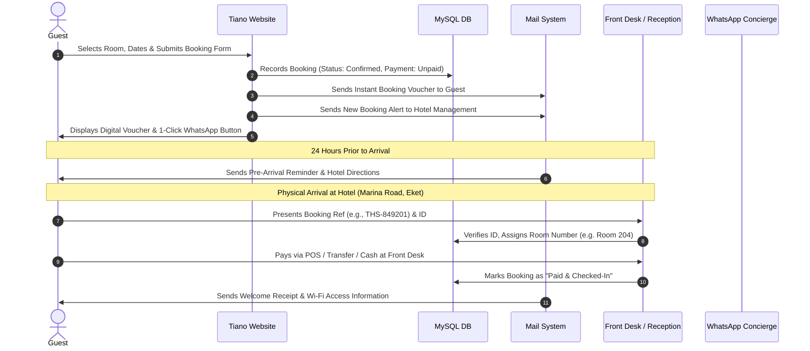

# Tiano Hotel & Suites — Comprehensive Management System Specification & PHP Architecture

> **Document Type:** Full System Architecture, Operations Blueprint & PHP Migration Roadmap  
> **Target Property:** Tiano Hotel and Suites (44 Marina Road, Eket, Akwa Ibom State, Nigeria)  
> **Revision:** 2.0 (Expanded with Physical Check-In Operations, Multi-Stage Notifications, Reviews & Housekeeping)  
> **Status:** Specification Phase (Review & Approval Required Before Code Execution)  
> **Tech Stack:** PHP 8.x, MySQL/MariaDB (Local XAMPP / Remote Apache), Bootstrap 5, Boxicons, Flaticon, WhatsApp API Bridge  

---

## Table of Contents
1. [Executive Vision & Core Tenets](#1-executive-vision--core-tenets)
2. [Physical Payment & Reservation Model (Pay-on-Arrival)](#2-physical-payment--reservation-model-pay-on-arrival)
3. [End-to-End Guest Booking & Check-In Operations](#3-end-to-end-guest-booking--check-in-operations)
4. [Multi-Stage Automated Notification Pipeline](#4-multi-stage-automated-notification-pipeline)
5. [Guest Reviews & Feedback Management System](#5-guest-reviews--feedback-management-system)
6. [Special Booking Requests & Corporate Inquiries Pipeline](#6-special-booking-requests--corporate-inquiries-pipeline)
7. [Housekeeping & Room Inventory Control](#7-housekeeping--room-inventory-control)
8. [Admin Management Dashboard Architecture (`/admin`)](#8-admin-management-dashboard-architecture-admin)
9. [Relational Database Schema (MySQL / XAMPP)](#9-relational-database-schema-mysql--xampp)
10. [PHP Migration & Modularization Roadmap](#10-php-migration--modularization-roadmap)

---

## 1. Executive Vision & Core Tenets

The goal of this system is to upgrade the current static HTML presentation into a dynamic, production-grade **Hotel Property Management & Booking Platform**. 

### Foundational Principles:
1. **Zero Gateway Friction (No Online Payments):** Eliminate transaction drop-offs and fees by operating on a **Pay-on-Arrival** model. Guests reserve without credit card barriers; payment is finalized physically at 44 Marina Road, Eket.
2. **Unified Omnichannel Communication:** Instant synchronization between **Email receipts** and **1-click WhatsApp messaging**, matching the preferred communication mode of Nigerian corporate travelers and local guests.
3. **Operational Completeness:** Cover the full real-world lifecycle of hotel management: reservation placement, physical arrival identity check, room key allocation, incidental room charges, housekeeping cleanliness status, checkout folios, and post-stay reviews.
4. **Front-End Aesthetic Consistency:** The admin dashboard will completely adopt the visual style, typography, border-radii, buttons, and dark/light modes of the public site, completely avoiding the look of generic, unbranded AI templates.

---

## 2. Physical Payment & Reservation Model (Pay-on-Arrival)

Because online payment processing is intentionally excluded, the financial workflow operates with strict physical verification:

```
[Online Booking Placed] 
       │
       ▼
[Status: Confirmed / Unpaid] (Room Held with Guaranteed Hold Cut-off)
       │
       ▼
[Physical Guest Arrival at 44 Marina Road, Eket]
       │
       ├── Payment via Physical POS Terminal (Card Swipe/Tap) -> Staff records POS RRN/Auth Code
       ├── Payment via Direct Bank Transfer -> Staff verifies Bank Narration & Session ID
       └── Payment via Cash -> Cashier generates Official Printed Receipt
       │
       ▼
[Front Desk Dashboard: Status updated to 'Paid & Checked-In']
```

### Financial Reconciliation Safeguards:
* **Automated Price Computation:** System computes:  
  $$\text{Total Bill} = (\text{Nightly Rate} \times \text{Nights}) + \text{Caution Deposit (Optional)}$$
* **Reservation Hold Cut-Off Window:** Unpaid reservations are held until **6:00 PM on check-in day**. If the guest has not arrived or re-confirmed arrival via WhatsApp, the system flags the booking as `Pending Hold Expiry`, allowing staff to release the room for walk-ins.
* **Caution / Incidental Deposit Log:** Front desk can record refundable caution deposits (e.g. ₦10,000) to cover laundry, bar tabs, or damages, refunded or reconciled upon checkout.

---

## 3. End-to-End Guest Booking & Check-In Operations



### The Physical Check-In Protocol:
1. **Identity Capture:** Front desk records Government ID type (NIN, Driver’s License, International Passport, Voter’s Card) and ID number.
2. **Specific Room Allotment:** When booking online, the guest chooses a *Category* (e.g., Diamond Room). Upon physical arrival, the receptionist assigns a specific *Physical Room Number* (e.g., Room 104 or Room 208) based on clean room inventory.
3. **Printable Registration Card:** 1-click generation of the standard Nigerian hotel guest registration card for physical signature.

---

## 4. Multi-Stage Automated Notification Pipeline

Communication is orchestrated across 5 automated milestones:

| Milestone | Channel | Trigger | Content & Actionable Elements |
| :--- | :--- | :--- | :--- |
| **1. Instant Reservation** | Email & On-Screen Voucher | Guest completes web form | Unique Reference ID (`THS-XXXXXX`), summary of dates, room rate, payment on arrival notice, hotel address, and 1-click WhatsApp concierge link. |
| **2. 24h Pre-Arrival Reminder** | Email & WhatsApp Prompt | 24 hours before check-in | Reminds guest of reservation, confirms check-in time (from 1:00 PM), offers driving directions on Marina Road, Eket, and requests estimated arrival time. |
| **3. Welcome & Check-In Receipt** | Email | Front desk clicks *Check-In* | Acknowledges physical payment, details assigned room number, Wi-Fi password, complimentary breakfast hours (6:30 AM–10:00 AM), and gym/pool hours. |
| **4. Morning of Check-Out Notice** | Email / SMS/WA | 10:00 AM on check-out day | Courteous notice that standard check-out is 12:00 PM; explains late check-out policy (charges apply after 6:00 PM). |
| **5. Post-Stay & Review Request** | Email & WhatsApp | 2 hours post checkout | Thank-you message from management + secure 1-click link to leave a 5-star rating and review. |

### Real-Time Admin Sound & Email Notifications:
* **Admin Dashboard Audio Bell:** When reception staff has the dashboard open, a gentle audible chime sounds and an unread badge increments whenever a new reservation lands.
* **Daily Morning Manifest (7:00 AM):** Automated email sent to General Manager / Head Receptionist listing today's expected check-ins, check-outs, and pending arrivals.

---

## 5. Guest Reviews & Feedback Management System

To build social proof while safeguarding the hotel's brand reputation:

### The Review Flow:
1. **Private Submission Form:** Guests access a clean feedback form via their post-stay email/WhatsApp link.
2. **Evaluation Metrics:**
   * Star rating (1 to 5 stars).
   * Key ratings: Cleanliness, Staff Courtesy, Security, Food & Breakfast, Wi-Fi Speed.
   * Freeform testimonial comment.
3. **Admin Moderation Desk in `/admin`:**
   * All incoming reviews arrive with status `Pending Moderation`.
   * **Approved Reviews:** Published directly to the live website testimonials carousel.
   * **Critique / Complaints (1–3 Stars):** Flagged privately for management. Features a 1-click button to contact the guest on WhatsApp or email to resolve complaints professionally.

---

## 6. Special Booking Requests & Corporate Inquiries Pipeline

Beyond individual standard room reservations, luxury hotels in Eket handle high-value group and corporate contracts (especially oil & gas servicing firms).

### Supported Inquiry Categories:
1. **Corporate & Contractor Long-Stay Packages:** Weekly or monthly discounted rates for project teams.
2. **Event & Bush Bar Reservations:** Private cocktail parties, celebrations, and outdoor poolside gatherings.
3. **Conference / Hall Inquiries:** Boardroom meetings and executive retreats.
4. **Airport Transfer & Escort Requests:** Chauffeur pickup from Victor Attah International Airport (Uyo) to Eket.

### The Pipeline Architecture:
* Dedicated tab in Admin Dashboard: `Inquiries & Corporate Requests`.
* Instant email dispatch to `tianohotel@gmail.com` with full company name, contact person, number of rooms, and projected budget.
* Staff can convert an inquiry directly into a bulk reservation with one click.

---

## 7. Housekeeping & Room Inventory Control

To prevent front-desk staff from inadvertently checking guests into uncleaned or damaged rooms:

### Room Cleanliness Lifecycle:
$$\text{Occupied} \xrightarrow{\text{Check-Out}} \text{Dirty / Cleaning Required} \xrightarrow{\text{Housekeeper Cleans}} \text{Inspected & Ready} \xrightarrow{\text{Check-In}} \text{Occupied}$$

* **Dashboard Room Matrix:**
  * Displays every physical room (e.g. Room 101 to Room 150) color-coded:
    * 🟢 **Green:** Clean, Inspected & Available
    * 🔵 **Blue:** Occupied
    * 🟡 **Yellow:** Dirty (Housekeeping in progress)
    * 🔴 **Red:** Maintenance / Out of Order
* **Housekeeper View:** Simplified mobile-friendly dashboard where cleaning staff can tap a button to mark a room as `Cleaned & Inspected`.

---

## 8. Admin Management Dashboard Architecture (`/admin`)

The administration area will be placed in `/admin/` and protected with session authentication and password encryption.

### Dashboard Layout & Modules:
1. **Command Center (Overview):**
   * Metrics Cards: Today's Arrivals, Today's Departures, Occupancy %, Expected Physical Revenue (NGN).
   * Real-time Room Cleanliness Status donut chart.
   * Recent Bookings list with status indicators.
2. **Bookings Manager:**
   * Status filter tabs: `All`, `Pending`, `Confirmed`, `Checked-In`, `Completed`, `Cancelled`.
   * Search: Guest name, booking ref, phone number, dates.
   * Action buttons per row:
     * 🟢 **WhatsApp Guest:** Pre-formats tailored arrival/confirmation message.
     * 🔵 **View/Print Folio:** Formatted guest bill and check-in slip.
     * 🟡 **Check-In:** Prompts for ID number, assigned room number, and payment confirmation.
     * 🔴 **Cancel / No-Show:** Frees inventory.
3. **Room Inventory & Rates Manager:**
   * Adjust nightly rates instantly without editing PHP files.
   * Toggle maintenance states.
4. **Reviews & Testimonials Moderation:**
   * Review queue, approve for homepage display, private reply on WhatsApp.
5. **Inquiries Desk:**
   * Corporate inquiries, group requests, contact form messages.

---

## 9. Relational Database Schema (MySQL / XAMPP)

Designed for MySQL / MariaDB in XAMPP:

```sql
-- 1. Room Categories
CREATE TABLE `room_categories` (
  `id` INT AUTO_INCREMENT PRIMARY KEY,
  `slug` VARCHAR(50) UNIQUE NOT NULL,
  `name` VARCHAR(100) NOT NULL,
  `price_per_night` DECIMAL(10,2) NOT NULL,
  `bed_type` VARCHAR(100) NOT NULL,
  `capacity` VARCHAR(50) NOT NULL,
  `description` TEXT,
  `thumbnail` VARCHAR(255) NOT NULL,
  `created_at` TIMESTAMP DEFAULT CURRENT_TIMESTAMP
);

-- 2. Physical Individual Rooms
CREATE TABLE `rooms` (
  `id` INT AUTO_INCREMENT PRIMARY KEY,
  `room_number` VARCHAR(10) UNIQUE NOT NULL,
  `category_id` INT NOT NULL,
  `floor` INT DEFAULT 1,
  `cleanliness_status` ENUM('clean', 'dirty', 'maintenance') DEFAULT 'clean',
  `occupancy_status` ENUM('vacant', 'occupied') DEFAULT 'vacant',
  FOREIGN KEY (`category_id`) REFERENCES `room_categories`(`id`) ON DELETE CASCADE
);

-- 3. Bookings & Reservations
CREATE TABLE `bookings` (
  `id` INT AUTO_INCREMENT PRIMARY KEY,
  `booking_ref` VARCHAR(20) UNIQUE NOT NULL,
  `category_id` INT NOT NULL,
  `assigned_room_id` INT NULL,
  `guest_name` VARCHAR(150) NOT NULL,
  `guest_email` VARCHAR(150) NOT NULL,
  `guest_phone` VARCHAR(30) NOT NULL,
  `guest_whatsapp` VARCHAR(30) NULL,
  `check_in_date` DATE NOT NULL,
  `check_out_date` DATE NOT NULL,
  `total_nights` INT NOT NULL,
  `room_rate` DECIMAL(10,2) NOT NULL,
  `total_amount` DECIMAL(10,2) NOT NULL,
  `payment_method` VARCHAR(50) DEFAULT 'Pay at Hotel',
  `payment_status` ENUM('unpaid', 'paid', 'partially_paid') DEFAULT 'unpaid',
  `payment_reference` VARCHAR(100) NULL,
  `booking_status` ENUM('pending', 'confirmed', 'checked_in', 'completed', 'cancelled', 'no_show') DEFAULT 'confirmed',
  `guest_id_type` VARCHAR(50) NULL,
  `guest_id_number` VARCHAR(100) NULL,
  `caution_deposit` DECIMAL(10,2) DEFAULT 0.00,
  `special_requests` TEXT NULL,
  `created_at` TIMESTAMP DEFAULT CURRENT_TIMESTAMP,
  FOREIGN KEY (`category_id`) REFERENCES `room_categories`(`id`),
  FOREIGN KEY (`assigned_room_id`) REFERENCES `rooms`(`id`)
);

-- 4. Guest Reviews & Moderation
CREATE TABLE `reviews` (
  `id` INT AUTO_INCREMENT PRIMARY KEY,
  `booking_id` INT NULL,
  `guest_name` VARCHAR(150) NOT NULL,
  `guest_email` VARCHAR(150) NOT NULL,
  `rating` INT NOT NULL CHECK (rating BETWEEN 1 AND 5),
  `review_text` TEXT NOT NULL,
  `status` ENUM('pending', 'approved', 'rejected') DEFAULT 'pending',
  `created_at` TIMESTAMP DEFAULT CURRENT_TIMESTAMP,
  FOREIGN KEY (`booking_id`) REFERENCES `bookings`(`id`) ON DELETE SET NULL
);

-- 5. Special Inquiries & Event Bookings
CREATE TABLE `inquiries` (
  `id` INT AUTO_INCREMENT PRIMARY KEY,
  `inquiry_type` ENUM('corporate', 'event_bush_bar', 'long_stay', 'general') NOT NULL,
  `company_name` VARCHAR(150) NULL,
  `contact_name` VARCHAR(150) NOT NULL,
  `email` VARCHAR(150) NOT NULL,
  `phone` VARCHAR(30) NOT NULL,
  `expected_guests` INT DEFAULT 1,
  `proposed_dates` VARCHAR(100) NULL,
  `details` TEXT NOT NULL,
  `status` ENUM('new', 'contacted', 'converted', 'closed') DEFAULT 'new',
  `created_at` TIMESTAMP DEFAULT CURRENT_TIMESTAMP
);

-- 6. Admin Users
CREATE TABLE `admin_users` (
  `id` INT AUTO_INCREMENT PRIMARY KEY,
  `username` VARCHAR(50) UNIQUE NOT NULL,
  `email` VARCHAR(100) UNIQUE NOT NULL,
  `password_hash` VARCHAR(255) NOT NULL,
  `full_name` VARCHAR(100) NOT NULL,
  `role` ENUM('superadmin', 'manager', 'receptionist') DEFAULT 'receptionist',
  `last_login` DATETIME NULL,
  `created_at` TIMESTAMP DEFAULT CURRENT_TIMESTAMP
);
```

---

## 10. PHP Migration & Modularization Roadmap

The transition will convert static `.html` into modular `.php`:

1. **Modular Architecture:**
   * `includes/header.php`: Global `<head>`, Google verification, SEO, Open Graph tags.
   * `includes/topbar.php`: Hotel contact, address, languages.
   * `includes/navbar.php`: Dynamic navigation bar.
   * `includes/footer.php`: Footer widgets, newsletter form, scripts.
   * `includes/booking_modal.php`: The unified interactive reservation modal.
   * `config/db.php`: PDO database connection wrapper.
2. **Page Conversion Matrix:**
   * `index.html` $\rightarrow$ `index.php`
   * `about.html` $\rightarrow$ `about.php`
   * `room.html` $\rightarrow$ `rooms.php` (live database pricing)
   * `coral-room.html`, `gold-room.html`, `diamond-room.html`, `premium-room.html`, `presidentalsuite.html` $\rightarrow$ Dynamic PHP templates
   * `services.html` $\rightarrow$ `services.php`
   * `contact.html` $\rightarrow$ `contact.php`
   * `gallery.html` $\rightarrow$ `gallery.php`
3. **Controllers & Endpoints:**
   * `controllers/booking_handler.php`: Processes reservation, inserts to DB, dispatches dual emails.
   * `booking-confirmation.php`: Renders digital voucher + WhatsApp redirect.
   * `submit-review.php`: Review entry point.
4. **Admin Portal Implementation (`/admin`):**
   * `/admin/index.php`: Login screen.
   * `/admin/dashboard.php`: Management overview and metrics.
   * `/admin/bookings.php`: Bookings table and physical check-in handler.
   * `/admin/rooms.php`: Room matrix and housekeeping status.
   * `/admin/reviews.php`: Reviews approval and moderation.
   * `/admin/inquiries.php`: Event and corporate inquiries.

---
*End of Specification — Tiano Hotel & Suites Management System.*
