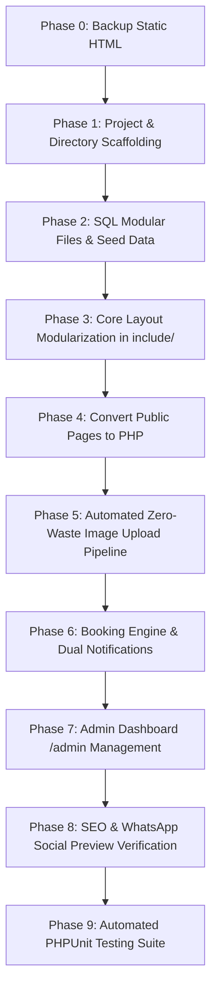

# Tiano Hotel & Suites — PHP Migration & Step-by-Step Implementation Roadmap

> **Document Type:** Step-by-Step Technical Execution Plan & Database Architecture  
> **Target Project:** `Tiano-Hotel` (44 Marina Road, Eket, Akwa Ibom State, Nigeria)  
> **Status:** Roadmap Phase (Awaiting User Authorization to Execute Step 1)  
> **Reference Architecture:** Follows the established PDO pattern in [`Weburea_Agency/include/pdoconfig.php`](file:///c:/xampp/htdocs/Weburea_Agency/include/pdoconfig.php) and [`Weburea_Agency/include/db.php`](file:///c:/xampp/htdocs/Weburea_Agency/include/db.php)  

---

## Table of Contents
1. [Execution Principles & Safety Protocols](#1-execution-principles--safety-protocols)
2. [Phase 0: Pre-Flight Safety & HTML Backup Strategy](#2-phase-0-pre-flight-safety--html-backup-strategy)
3. [Database & SQL Architecture (`sql/` Directory)](#3-database--sql-architecture-sql-directory)
4. [Database Connection Design (`include/pdoconfig.php` & `include/db.php`)](#4-database-connection-design-includepdoconfigphp--includedbphp)
5. [The 9 Step-by-Step Implementation Phases](#5-the-9-step-by-step-implementation-phases)
   - [Phase 1: Environment & Directory Scaffolding](#phase-1-environment--directory-scaffolding)
   - [Phase 2: Database Initialization & Seed Data](#phase-2-database-initialization--seed-data)
   - [Phase 3: Core Layout Modularization (`include/`)](#phase-3-core-layout-modularization-include)
   - [Phase 4: Public Frontend Conversion to PHP](#phase-4-public-frontend-conversion-to-php)
   - [Phase 5: Automated Zero-Waste Image Upload Pipeline](#phase-5-automated-zero-waste-image-upload-pipeline)
   - [Phase 6: Booking Engine, Physical Check-in & Dual Notifications](#phase-6-booking-engine-physical-check-in--dual-notifications)
   - [Phase 7: Admin Management Dashboard (`/admin`)](#phase-7-admin-management-dashboard-admin)
   - [Phase 8: SEO, Search Console & Social Preview Audit](#phase-8-seo-search-console--social-preview-audit)
   - [Phase 9: Automated PHPUnit & Quality Testing Suite](#phase-9-automated-phpunit--quality-testing-suite)
6. [Summary Checklist & Execution Readiness](#6-summary-checklist--execution-readiness)

---

## 1. Execution Principles & Safety Protocols

1. **Non-Destructive Transition:** The original static HTML pages will be safely archived before conversion.
2. **Strict Design Token Reuse:** Admin UI and newly dynamic components will strictly inherit the established visual system in [`doc/DESIGN_SYSTEM_AND_COMPONENTS.md`](file:///c:/xampp/htdocs/Tiano-Hotel/doc/DESIGN_SYSTEM_AND_COMPONENTS.md) (Tiano Crimson `#E73539`, `.default-btn` dual-wipe hover animation, Boxicons/Flaticons, `#1d1d1d`/`#252525` dark mode).
3. **Zero-Waste Disk Protection:** Raw multi-megabyte image uploads will never be saved permanently to cloud/server disk; they are compressed in memory to ~80–100 KB thumbnails and ~150–250 KB broad-view lightbox masters before discarding the raw temporary file.
4. **No Git Commits for Now:** Git commits remain paused until the user explicitly requests them.

---

## 2. Phase 0: Pre-Flight Safety & HTML Backup Strategy

Before converting or renaming any file, a dedicated archive directory will be created:

```text
Tiano-Hotel/
└── _html_backup/                     # Complete preserved snapshot of original static HTML
    ├── index.html
    ├── about.html
    ├── room.html
    ├── coral-room.html
    ├── gold-room.html
    ├── diamond-room.html
    ├── premium-room.html
    ├── presidentalsuite.html
    ├── services.html
    ├── luxurious_comfortable_accommodation.html
    ├── complimentary_gourmet_breakfast.html
    ├── modern_wellness_recreation_facilities.html
    ├── secured_environment.html
    ├── gallery.html
    ├── contact.html
    ├── privacy-policy.html
    ├── terms-condition.html
    ├── testimonials.html
    └── coming-soon.html
```
* **Guarantee:** If any unexpected issue arises during development, the exact original HTML files can be restored instantly with zero data loss.

---

## 3. Database & SQL Architecture (`sql/` Directory)

All SQL definitions will be cleanly modularized inside a dedicated `sql/` directory with separate files per table for granular auditing, plus a unified master file for 1-click phpMyAdmin import:

```text
Tiano-Hotel/
└── sql/
    ├── 01_room_categories.sql         # Room tiers (Coral, Gold, Diamond, Premium, Presidential)
    ├── 02_rooms.sql                   # Physical rooms (Room 101, 102, 201...) & cleanliness status
    ├── 03_bookings.sql                # Reservations, vouchers, payment on arrival & check-in folios
    ├── 04_gallery.sql                 # Gallery items (category, thumb_url, full_url, sort_order)
    ├── 05_services.sql                # Services directory and sub-service descriptions
    ├── 06_contact_messages.sql        # Guest inquiries, dual notification status, admin reply log
    ├── 07_newsletter_subscribers.sql  # Newsletter emails & subscribe timestamps
    ├── 08_faqs.sql                    # Dynamic accordion FAQs for the homepage
    ├── 09_reviews.sql                 # Guest ratings (1-5 stars) and moderation status
    ├── 10_inquiries.sql               # Corporate long-stays, event hall & bush bar bookings
    ├── 11_admin_users.sql             # Admin login credentials (hashed passwords)
    ├── 12_site_settings.sql           # Key-value store (phone numbers, email, banner notices)
    └── tiano_hotel_master.sql         # Unified master schema & seed data (1-click import)
```

---

## 4. Database Connection Design (`include/pdoconfig.php` & `include/db.php`)

Faithfully replicating the clean architectural pattern provided from `Weburea_Agency`:

### A. Credentials File: `include/pdoconfig.php`
```php
<?php
/**
 * Tiano Hotel & Suites — Database Connection Configuration
 * Switch between Localhost (XAMPP) and Hosted cPanel Server.
 */

// --- 1. LOCALHOST SETTINGS (Active for Local XAMPP Development) ---
$host    = 'localhost';
$db      = 'tiano_hotel_db';
$user    = 'root';
$pass    = '';
$charset = 'utf8mb4';

// --- 2. ONLINE HOSTING SETTINGS (Commented out for live deployment) ---
// $host    = 'localhost';
// $db      = 'tianohot_live_db';
// $user    = 'tianohot_dbuser';
// $pass    = 'YourSecureProductionPasswordHere';
// $charset = 'utf8mb4';
?>
```

### B. PDO Connection Handler: `include/db.php`
```php
<?php
/**
 * PDO Database Connection Wrapper
 * Enforces prepared statements and exception handling.
 */
require_once __DIR__ . '/pdoconfig.php';

$dsn = "mysql:host=$host;dbname=$db;charset=$charset";
$options = [
    PDO::ATTR_ERRMODE            => PDO::ERRMODE_EXCEPTION,
    PDO::ATTR_DEFAULT_FETCH_MODE => PDO::FETCH_ASSOC,
    PDO::ATTR_EMULATE_PREPARES   => false,
];

try {
    $pdo = new PDO($dsn, $user, $pass, $options);
} catch (\PDOException $e) {
    // Log privately; display safe error message
    error_log("Tiano Hotel DB Connection Error: " . $e->getMessage());
    die("A temporary database connection error occurred. Please try again shortly.");
}
?>
```

---

## 5. The 9 Step-by-Step Implementation Phases



---

### Phase 1: Environment & Directory Scaffolding
* **Task 1.1:** Create `_html_backup/` and copy all 19 existing `.html` files.
* **Task 1.2:** Create the directory structure:
  * `include/` — Layout components (`header.php`, `footer.php`, `navbar.php`, `booking_modal.php`) and database files.
  * `sql/` — Modular SQL schema files.
  * `admin/` — Admin dashboard and management controllers.
  * `controllers/` — Booking submission, contact handler, and image upload processors.
  * `assets/img/uploads/gallery/thumbs/` & `assets/img/uploads/gallery/full/` — Storage directories for optimized gallery images.

---

### Phase 2: Database Initialization & Seed Data
* **Task 2.1:** Create all 12 modular `.sql` table files in `sql/`.
* **Task 2.2:** Create `sql/tiano_hotel_master.sql` populated with initial seed data:
  * 5 Room Categories (Coral @ ₦35k, Gold @ ₦40k, Diamond @ ₦50k, Premium @ ₦65k, Presidential @ ₦250k).
  * Initial physical room inventory (Rooms 101–110, 201–210, etc.).
  * 4 Core Services with verified descriptions.
  * Homepage FAQ questions and answers.
  * Default Superadmin account (`admin` / secure temporary password hashed with `password_hash`).
* **Task 2.3:** Implement `include/pdoconfig.php` and `include/db.php`.

---

### Phase 3: Core Layout Modularization (`include/`)
* **Task 3.1:** Extract common markup into reusable PHP includes:
  * `include/header.php`: Global `<head>`, SEO meta tags, Open Graph tags, stylesheet links.
  * `include/topbar.php`: Hotel address (44 Marina Road), telephone (`+234 814 473 4612`), email.
  * `include/navbar.php`: Dynamic navigation bar with active page indicator and fixed lowercase URLs.
  * `include/footer.php`: Footer widgets, newsletter subscription form, copyright, JavaScript scripts.
  * `include/booking_modal.php`: The universal room reservation modal.
* **Task 3.2:** Ensure zero layout shift and complete JavaScript compatibility (`assets/js/custom.js`, MeanMenu, and Owl Carousel).

---

### Phase 4: Public Frontend Conversion to PHP
Convert static HTML pages to clean, dynamic PHP templates:
* **Task 4.1:** `index.php`: Dynamic hero headline, featured rooms, services overview, FAQ accordion from database.
* **Task 4.2:** `about.php`: Dynamic mission, vision, and facility stats.
* **Task 4.3:** `rooms.php`: Live room cards, nightly rates, capacity, and direct modal booking triggers.
* **Task 4.4:** `coral-room.php`, `gold-room.php`, `diamond-room.php`, `premium-room.php`, `presidentalsuite.php`: Dynamic in-room amenities, bed sizes, and photo sliders.
* **Task 4.5:** `services.php` & service detail pages (`luxurious_comfortable_accommodation.php`, `complimentary_gourmet_breakfast.php`, `modern_wellness_recreation_facilities.php`, `secured_environment.php`).
* **Task 4.6:** `gallery.php`: Categorized gallery tabs rendering database images.
* **Task 4.7:** `contact.php`: Dynamic contact form with dual-notification engine.
* **Task 4.8:** `privacy-policy.php` & `terms-condition.php`.

---

### Phase 5: Automated Zero-Waste Image Upload Pipeline
* **Task 5.1:** Build `controllers/upload_gallery_image.php` using PHP GD:
  * Validates upload MIME type (`image/jpeg`, `image/png`, `image/webp`).
  * Streams raw 3MB–10MB upload directly in memory without saving to permanent disk.
  * Resamples & compresses grid thumbnail to `800x600px` WebP @ 80% (size: **80 KB – 100 KB**).
  * Resamples & compresses broad-view lightbox master to `1920px` WebP @ 82% (size: **150 KB – 250 KB**).
  * Unlinks and purges the incoming temporary raw file immediately.
* **Task 5.2:** Bind the output to the existing `gallery.html` markup:
  ```html
  <div class="single-gallery">
      
      <a href="assets/img/uploads/gallery/full/photo_full.webp" class="gallery-icon">
          <i class="bx bx-plus"></i>
      </a>
  </div>
  ```
  *(Preserving the exact Magnific Popup lightbox configuration in `assets/js/custom.js`).*

---

### Phase 6: Booking Engine, Physical Check-in & Dual Notifications
* **Task 6.1:** Build `controllers/process_booking.php`:
  * Validates dates, calculates total nights, nightly room rate, and refundable caution deposit.
  * Generates unique Booking Reference ID (`THS-XXXXXX`).
  * Inserts booking into `bookings` table with status `Confirmed` (Payment: `Pay on Arrival`).
* **Task 6.2:** Dual-Notification Engine via PHPMailer (`include/mailer.php`):
  * SMTP Server: `s9621.fra1.stableserver.net:465` (SSL) / `support@tianohotelandsuites.com`.
  * **To Guest:** Styled HTML booking confirmation pass + check-in instructions + direct link to digital voucher.
  * **To Hotel Admin (`support@tianohotelandsuites.com`):** Real-time new reservation alert email with guest details and dates.
* **Task 6.3:** Post-Booking Digital Voucher Screen (`voucher.php`):
  * Displays printable luxury pass with room details, dates, and total payable upon physical arrival.
  * Features 1-click **"WhatsApp Concierge"** button pre-populated with reference ID and room details.
  * Strict A4 1-page print layout guarantee and Tiano Crimson (`#E73539`) brand palette.

---

### Phase 7: Admin Management Dashboard (`/admin`)
> **Detailed Documentation & Guide:** Refer to [`doc/ADMIN_PORTAL_AND_MANAGEMENT_SYSTEM.md`](file:///c:/xampp/htdocs/Tiano-Hotel/doc/ADMIN_PORTAL_AND_MANAGEMENT_SYSTEM.md) for complete architecture, authentication flow, and operational procedures.

* **Task 7.1:** `/admin/index.php` & Auth Security:
  * Secure login screen using `password_verify` and session security (`session_regenerate_id`).
  * **Email Verification Check:** System enforces verified status (`is_verified = 1`) before granting administrative access.
  * **Password Recovery & OTP Flow (`/admin/forgot-password.php` & `/admin/reset-password.php`):** Sends 6-digit OTP code and secure reset link via PHPMailer to the staff member's company email.
  * **Email Verification Desk (`/admin/verify-email.php`):** Allows unverified staff to submit 6-digit email confirmation code with instant resend trigger.
* **Task 7.2:** `/admin/dashboard.php` — Overview command center (Today's check-ins, check-outs, occupancy %, expected revenue).
* **Task 7.3:** `/admin/bookings.php` — Reservation management:
  * Status filters: `Pending`, `Confirmed`, `Checked-In`, `Completed`, `Cancelled`.
  * Physical Check-In Modal: Prompts for Guest ID verification, physical room number assignment (e.g. Room 204), and payment confirmation (POS, Cash, Transfer).
  * 1-Click WhatsApp messaging directly to the guest.
  * Printable guest folio / registration card.
* **Task 7.4:** `/admin/rooms.php` — Room inventory & cleanliness matrix (Clean 🟢, Occupied 🔵, Dirty 🟡, Maintenance 🔴).
* **Task 7.5:** `/admin/gallery.php` — Gallery image upload manager with automated zero-waste WebP compression.
* **Task 7.6:** `/admin/messages.php` — Inquiries & contact form messages inbox.
* **Task 7.7:** `/admin/newsletter.php` — Empty subscriber holding page prepared for the next phase as instructed.
* **Task 7.8:** `/admin/reviews.php` — Guest review moderation desk.

---

### Phase 8: SEO, Search Console & Social Preview Audit
* **Status:** Completed & 100% Verified.
* **Task 8.1: Page-by-Page Distinct Canonical URLs (`<link rel="canonical" href="...">`):**
  * Implemented dynamically in `include/head-seo.php` resolving against the canonical production domain stored in `site_settings` (`site_url`).
  * All 20+ public frontend templates generate clean, non-collapsing canonical paths (e.g. `https://www.tianohotel.com/`, `https://www.tianohotel.com/coral-room.php`, `https://www.tianohotel.com/booking.php`).
* **Task 8.2: Google Search Console Verification & Conversion Tracking:**
  * Embedded Google site verification meta tag (`5-EKPDU79tZaKmn1btvlHzB_y37AlAtf5JlkfotV5PQ`) globally across all frontend headers.
  * Embedded Google Analytics / Google Ads conversion tracking script (`AW-17974817149`) with asynchronous gtag.js execution.
* **Task 8.3: WhatsApp & Social Media Open Graph Optimization:**
  * Global tags: `og:locale`, `og:site_name`, `og:type`, `og:url`, `og:title`, `og:description`, `og:image`, `og:image:secure_url`, `og:image:width`, `og:image:height`.
  * Dedicated legacy crawler fallback: `<link rel="image_src" href="...">`.
  * Twitter Cards: `summary_large_image`, `twitter:site` (`@tianohotel`), `twitter:title`, `twitter:description`, `twitter:image`.
  * **Zero-Fail WhatsApp Limit Verification:** The primary preview image (`assets/img/og-preview.jpg`) is verified at **107 KB** (well within WhatsApp's strict 300 KB ceiling).
  * Page-specific previews: Room pages share their respective high-res room suite photographs; blog articles share their featured photography; service pages share their facility visual.
* **Task 8.4: Schema.org JSON-LD Structured Data:**
  * Embedded `Hotel` entity on all pages with precise GPS coordinates (`4.6439, 7.9304`), telephone (`+234 814 473 4612`), price range (`₦35,000 - ₦250,000`), currencies accepted (`NGN`), 24/7 opening hours (`Mo-Su 00:00-24:00`), and location amenities.
  * Embedded `HotelRoom` schema on room detail pages with bed types, max occupancy, and currency-formatted price offers.
  * Embedded `Article` schema on editorial blog articles with author, datePublished, and publisher.
  * Embedded `AggregateRating` and `Review` schema on guest testimonials page (`testimonials.php`).
* **Task 8.5: Dual XML Sitemap:**
  * Static `sitemap.xml` generated adhering to standard XML schemas (`http://www.sitemaps.org/schemas/sitemap/0.9`).
  * Dynamic `sitemap.php` that continuously syncs URLs with database `site_url`.
* **Task 8.6: Search Crawler Shield (`robots.txt` & `.htaccess`):**
  * `robots.txt`: Disallows `/admin/`, `/include/`, `/controllers/`, `/sql/`, `/doc/`, `/_html_backup/`, `/vendor/`, `/voucher.php`, and `/clear_cache.php`. Declares canonical `Sitemap: https://www.tianohotel.com/sitemap.xml`.
  * Root `.htaccess`: Injects `X-Robots-Tag: noindex, nofollow, noarchive, nosnippet` on internal paths; protects sensitive `.sql`, `.log`, `.env`, and config files; enables security headers (`nosniff`, `SAMEORIGIN`, XSS protection).
  * `admin/.htaccess`: Intercepts search bot User-Agents (Googlebot, Bingbot, YandexBot, etc.) with a `403 Forbidden` while allowing human staff access with `X-Robots-Tag: noindex`.
  * HTML tags: `<meta name="robots" content="noindex, nofollow, noarchive, nosnippet, noimageindex">` across all admin auth and layout headers.

---

### Phase 9: Automated PHPUnit & Quality Testing Suite
* **Status:** Completed & 100% Verified (14/14 Automated Tests Passing).
* **Task 9.1: Test Suite Architecture:**
  * Created dedicated `tests/` directory with `tests/Unit/` test cases and `tests/run_tests.php` runner.
  * Configured `phpunit.xml.dist` for standard Composer PHPUnit execution.
* **Task 9.2: Booking Calculation & Financial Logic (`tests/Unit/BookingCalculationTest.php`):**
  * Validates date diffing algorithms and default single-night fallback.
  * Validates room rate multiplication across all 5 luxury room tiers.
  * Validates dynamic caution deposit toggle logic (adds deposit when active, completely omits ₦0 when hidden).
  * Validates booking reference format regular expression (`/^THS-[A-Z0-9]{6}$/`).
* **Task 9.3: Authentication & Security Integrity (`tests/Unit/AuthSecurityTest.php`):**
  * Validates BCRYPT password hashing and timing-safe verification.
  * Validates 64-character cryptographic entropy for CSRF tokens.
  * Validates 6-digit numeric OTP generation for staff password reset and email verification.
* **Task 9.4: SEO & Compliance Audit (`tests/Unit/SeoAuditTest.php`):**
  * Validates `sitemap.xml` syntax, non-emptiness, and inclusion of all core routes.
  * Validates `robots.txt` disallows `/admin/` and references the canonical sitemap.
  * Validates `admin/.htaccess` enforces `noindex` and `X-Robots-Tag`.
  * Validates `include/head-seo.php` presence of canonical tags, Open Graph tags, Twitter tags, and Schema.org JSON-LD.
  * Validates `og-preview.jpg` remains strictly below the 300 KB WhatsApp ceiling.

---

## 6. Summary Checklist & Execution Readiness

| Phase | Milestone Description | Status |
| :---: | :--- | :---: |
| **0** | Backup all 19 original static HTML files to `_html_backup/` | **Completed** |
| **1** | Directory scaffolding (`include/`, `sql/`, `admin/`, `controllers/`, `uploads/`) | **Completed** |
| **2** | Modular SQL schemas (12 files + master schema) & DB connection setup | **Completed** |
| **3** | Core template layout modularization in `include/` | **Completed** |
| **4** | Dynamic PHP conversion of public pages | **Completed** |
| **5** | Automated zero-waste image compression pipeline (GD/WebP ~100 KB) | **Completed** |
| **6** | Booking engine, physical pay-on-arrival voucher & dual email notifications | **Completed** |
| **7** | Admin Dashboard management suite (`/admin`) | **Completed** |
| **8** | SEO canonical audit, Search Console readiness & WhatsApp social previews | **Completed & Verified** |
| **9** | Automated PHPUnit & Quality Testing Suite (14/14 tests passing) | **Completed & Verified** |

---
*End of Migration Roadmap — Tiano Hotel & Suites.*
